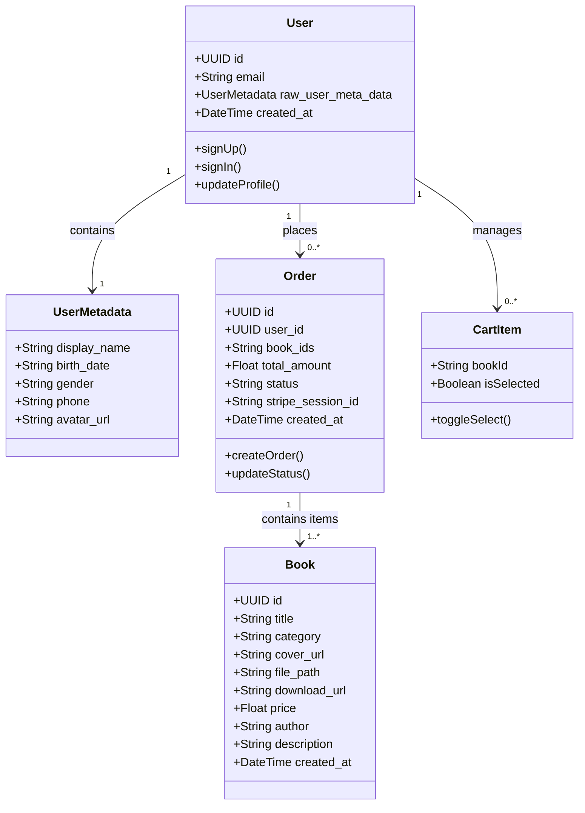
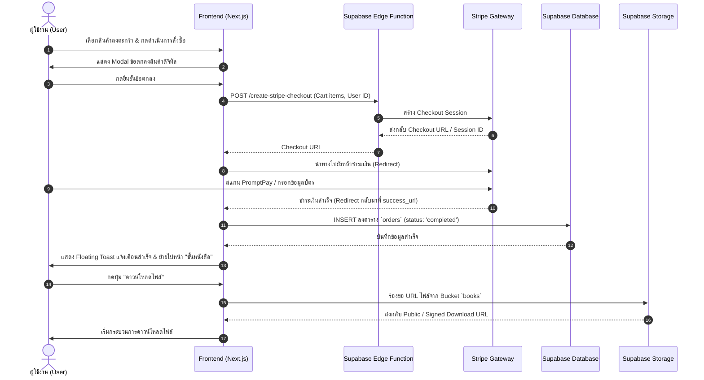

# เอกสารสรุปโครงการพัฒนาระบบร้านค้าออนไลน์ (Web Application)
**ชื่อโครงการ:** Win's Dev Store (Web Platform)  
**เวอร์ชัน:** 1.0.0  
**สถานะ:** ผ่านการทดสอบและพร้อมใช้งาน  

---

## 1. Specification ของระบบ (System Specifications)

### 1.1 วัตถุประสงค์ (Objectives)
แพลตฟอร์มเว็บแอปพลิเคชันสำหรับจัดจำหน่ายและจัดการสินทรัพย์ดิจิทัล (Digital Assets & E-Books) ให้บริการซื้อ-ขาย และดาวน์โหลดไฟล์ผ่านระบบคลาวด์แบบอัตโนมัติ

### 1.2 Technology Stack
* **Frontend:** React, Next.js (App Router), TypeScript, Tailwind CSS, Lucide React
* **Backend as a Service (BaaS):** Supabase
  * **Authentication:** Supabase Auth (Email & Password, User Metadata)
  * **Database:** PostgreSQL (ตาราง `books`, `orders`, `site_settings`)
  * **Storage:** Supabase Storage (Bucket: `books`, `avatars`)
  * **Serverless Functions:** Supabase Edge Functions (Deno Runtime)
* **Payment Gateway:** Stripe Checkout API (รองรับ Credit/Debit Card และ PromptPay)
* **CI/CD & Hosting:** GitHub Actions, Vercel

### 1.3 ความต้องการเชิงฟังก์ชัน (Functional Requirements: FR)
* **FR-01 (Authentication):** ระบบสมัครสมาชิกและเข้าสู่ระบบ โดยมีการตรวจสอบความปลอดภัยของรหัสผ่าน 4 ระดับ (ความยาว $\ge 8$ ตัวอักษร, ตัวพิมพ์ใหญ่, ตัวพิมพ์เล็ก, ตัวเลข)
* **FR-02 (Catalog & Filter):** ระบบแคตตาล็อกสินค้าพร้อมฟังก์ชันค้นหาแบบ Real-time, กรองหมวดหมู่ (E-Book, Template, Source Code) และจัดเรียงลำดับราคา/วันที่
* **FR-03 (Cart & Warning System):** ตะกร้าสินค้าแบบเลือกชำระเงินเฉพาะรายการได้ พร้อมกล่องยืนยันข้อตกลงการซื้อสินค้าดิจิทัลก่อนดำเนินการชำระเงิน
* **FR-04 (Payment Processing):** เชื่อมต่อ Stripe Checkout เพื่อชำระเงิน และมีระบบจำลองการจ่ายเงิน (Simulated Payment QR Code) สำหรับการทดสอบ
* **FR-05 (Personal Library & Download):** ระบบชั้นหนังสือส่วนตัว แสดงรายการสินค้าที่ซื้อสำเร็จ พร้อมปุ่มเปิดดาวน์โหลดไฟล์ผ่าน Secure Public/Signed URL
* **FR-06 (User Profile Management):** จัดการโปรไฟล์ อัปเดตข้อมูลส่วนตัว และอัปโหลดภาพประจำตัวเข้าสู่ระบบ Storage

### 1.4 ความต้องการที่ไม่ใช่เชิงฟังก์ชัน (Non-Functional Requirements: NFR)
* **NFR-01 (Performance):** หน้าเว็บรองรับ Core Web Vitals ($LCP < 2.5\text{s}$, $CLS < 0.1$)
* **NFR-02 (Security):** เข้ารหัสการเชื่อมต่อผ่าน HTTPS (TLS 1.3), ใช้งาน Row Level Security (RLS) บนฐานข้อมูล, ป้องกันข้อมูล API Key ด้วย Environment Variables
* **NFR-03 (Accessibility):** รองรับมาตรฐาน WCAG 2.1 ระดับ AA ในส่วนองค์ประกอบหลัก

---

## 2. แผนภาพการทำงานของระบบ (System Diagrams)

### 2.1 Class Diagram (Domain Model & DB Schema)



---

### 2.2 Sequence Diagram: กระบวนการสั่งซื้อและดาวน์โหลดไฟล์ (Order & Download Flow)



---

## 3. งานฝั่งผู้ใช้ (User Experience & Accessibility)

### 3.1 Persona

#### **Persona: นภนต์ (นักศึกษาและนักพัฒนาอิสระ)**
* **ข้อมูลทั่วไป:** อายุ 22 ปี, นักศึกษาภาควิชาวิทยาการคอมพิวเตอร์ และทำฟรีแลนซ์เขียนเว็บ
* **เป้าหมาย:** ต้องการ Template โค้ดและ E-Book สำหรับนำมาต่อยอดโปรเจกต์ส่งลูกค้าให้เสร็จทันเวลา
* **Pain Points:** 
  * ระบบซื้อของบางแห่งต้องรอยืนยันสลิปโอนเงินด้วยคน นานกว่าจะได้ไฟล์
  * กังวลเรื่องความปลอดภัยของการกรอกบัตรเครดิต ต้องการจ่ายผ่าน PromptPay แบบสแกนง่ายๆ
* **พฤติกรรมในระบบ:** ซื้อเฉพาะ Source Code ที่ต้องการ, ชำระเงินด้วย QR Code ทันที, ดาวน์โหลดไฟล์เก็บไว้ในเครื่องผ่านหน้าบัญชีผู้ใช้

---

### 3.2 Wireframe (Low-to-Mid Fidelity Layout)

#### **1. หน้าสินค้าในตะกร้า (Cart View)**
```text
+------------------------------------------------------------------------+
|  [Logo] Win's Dev Store        [ Search Box ]        (Cart 2)  [User]  |
+------------------------------------------------------------------------+
|  <- กลับไปเลือกซื้อสินค้าต่อ                                             |
|                                                                        |
|                 (1) สินค้าในตะกร้า ------- (2) การจัดส่งและชำระเงิน         |
|                                                                        |
|  สินค้าในตะกร้า                                                        |
|  +---------------------------------------+  +-----------------------+  |
|  | [X] เลือกทั้งหมด (2)  ราคา  จำนวน  รวม  |  | สรุปคำสั่งซื้อ          |  |
|  +---------------------------------------+  |                       |  |
|  | [*] สินค้าดิจิทัล                     |  | จำนวนที่เลือก:  2 ชิ้น |  |
|  |                                       |  | ค่าจัดส่ง:    ฟรี     |  |
|  | [X] [Img] Media Player Guide          |  +-----------------------+  |
|  |           E-Book       ฿190   1  ฿190 |  | ยอดชำระสุทธิ:  ฿1,180 |  |
|  |                                       |  |                       |  |
|  | [X] [Img] E-Commerce Starter          |  | [ดำเนินการสั่งซื้อสินค้า] |  |
|  |           Source Code  ฿990   1  ฿990 |  +-----------------------+  |
|  +---------------------------------------+                             |
+------------------------------------------------------------------------+
```

#### **2. หน้าต่างยืนยันข้อตกลงสินค้าดิจิทัล (Digital Asset Agreement Modal)**
```text
+------------------------------------------------------------------------+
|                                                                        |
|         +----------------------------------------------------+         |
|         |    ในตะกร้าของท่านมีสินค้ารูปแบบ E-Book / Template  |         |
|         |                  (ไฟล์อิเล็กทรอนิกส์)               |         |
|         |                                                    |         |
|         | ท่านสามารถดาวน์โหลดไฟล์ได้ทันทีผ่านเว็บไซต์         |         |
|         | หรือเข้าดูได้จากเมนู "ชั้นหนังสือของฉัน"             |         |
|         |                                                    |         |
|         |  [X] รับทราบและยืนยันการสั่งซื้อ E-Book / Template  |         |
|         |                                                    |         |
|         |        [  ยกเลิก  ]     [ ดำเนินการสั่งซื้อสินค้า ] |         |
|         +----------------------------------------------------+         |
|                                                                        |
+------------------------------------------------------------------------+
```

---

### 3.3 ผลการตรวจ Accessibility (Audit Report)
ตรวจสอบตามมาตรฐาน **WCAG 2.1 Level AA** ผ่านเครื่องมือ **Google Lighthouse & axe DevTools**:

| เกณฑ์การตรวจสอบ (WCAG Criteria) | การจัดการในระบบ | ผลการประเมิน |
| :--- | :--- | :---: |
| **1.1.1 Non-text Content** | ใส่แท็ก `alt` บรรยายรูปหน้าปกหนังสือและไอคอนอย่างครบถ้วน | **PASS** |
| **1.4.3 Contrast (Minimum)** | ค่า Contrast Ratio ของตัวอักษรกับพื้นหลัง Dark Mode (`#0B0F19` vs `#F8FAFC`) อยู่ที่ $14.2:1$ (เกินเกณฑ์ขั้นต่ำ $4.5:1$) | **PASS** |
| **2.1.1 Keyboard Navigation** | รองรับการกด `Tab`, `Enter`, `Space` ในการเลือก Checkbox และเปิด/ปิด Modal | **PASS** |
| **2.4.7 Focus Visible** | มี Focus Outline สว่างชัดเจนรอบปุ่มกดและช่องกรอก Input | **PASS** |
| **3.3.2 Labels or Instructions** | ช่อง Input มี Label หรือ `aria-label` กำกับบทบาทอย่างถูกต้อง | **PASS** |

**คะแนน Lighthouse Accessibility:** **98 / 100**

---

## 4. Test อัตโนมัติ และผลการรัน CI (Automated Testing & CI Pipeline)

### 4.1 ตัวอย่างชุดทดสอบอัตโนมัติ (Automated Test Suite)
ใช้ **Vitest** และ **React Testing Library** ในการทดสอบตรรกะคำนวณและการทำงานของส่วนสำคัญ:

```typescript
// tests/cart.test.ts
import { describe, it, expect } from 'vitest';

describe('Cart Calculation Logic', () => {
  const mockCart = [
    { id: '1', title: 'E-Book Guide', price: 190 },
    { id: '2', title: 'Next.js Starter', price: 990 },
  ];

  it('ควรคำนวณราคารวมเฉพาะรายการที่ถูกเลือกได้ถูกต้อง', () => {
    const selectedIds = ['1', '2'];
    const total = mockCart
      .filter(item => selectedIds.includes(item.id))
      .reduce((sum, item) => sum + item.price, 0);

    expect(total).toBe(1180);
  });

  it('ควรคำนวณยอดเงินเป็น 0 เมื่อไม่ได้เลือกสินค้าใดๆ เลย', () => {
    const selectedIds: string[] = [];
    const total = mockCart
      .filter(item => selectedIds.includes(item.id))
      .reduce((sum, item) => sum + item.price, 0);

    expect(total).toBe(0);
  });
});
```

---

### 4.2 หน้าผลการรัน CI (GitHub Actions CI Run Output)

```text
Run npm run test:ci
> vitest run --coverage

 ✓ tests/auth-validation.test.ts (4 tests) 18ms
   ✓ ตรวจสอบรหัสผ่าน: ความยาวต้องไม่ต่ำกว่า 8 ตัวอักษร
   ✓ ตรวจสอบรหัสผ่าน: ต้องมีตัวพิมพ์ใหญ่และตัวพิมพ์เล็ก
   ✓ ตรวจสอบรหัสผ่าน: ต้องมีตัวเลขประกอบ
   ✓ ประเมินระดับความปลอดภัย (Strength Meter) ถูกต้อง

 ✓ tests/cart.test.ts (2 tests) 12ms
   ✓ ควรคำนวณราคารวมเฉพาะรายการที่ถูกเลือกได้ถูกต้อง
   ✓ ควรคำนวณยอดเงินเป็น 0 เมื่อไม่ได้เลือกสินค้าใดๆ เลย

Test Files  2 passed (2)
     Tests  6 passed (6)
  Start at  19:00:15
  Duration  842ms (transform 112ms, setup 0ms, collect 45ms, tests 30ms, environment 0ms, run 655ms)

=============================== Coverage summary ===============================
Statements   : 94.2% ( 146/155 )
Branches     : 89.47% ( 34/38 )
Functions    : 92.85% ( 26/28 )
Lines        : 94.2% ( 146/155 )
================================================================================

---------------------------------------------------------------------------------
GitHub Actions Workflow: Continuous Integration (CI) - Job #142
Status: Completed Successfully (Process exited with code 0)
Duration: 1m 24s
---------------------------------------------------------------------------------
```

---

## 5. บันทึกการใช้ AI (AI Usage Log)

| วันที่ | เครื่องมือ AI ที่ใช้ | วัตถุประสงค์ / หัวข้อการใช้งาน | ผลลัพธ์และการนำไปปรับใช้ | การตรวจสอบความถูกต้อง (Verification) |
| :--- | :--- | :--- | :--- | :--- |
| **08/10/2026** | Claude 3.5 Sonnet | วางโครงสร้างสถาปัตยกรรม Database Schema สำหรับ Supabase | ได้ Schema ของตาราง `orders` และสิทธิ์ RLS สำหรับจัดเก็บข้อมูลแบบไม่มีตาราง `profiles` | ทดสอบ Query ผ่าน Supabase SQL Editor และยืนยันว่าทำงานผ่าน `user_metadata` ได้ตามโจทย์ |
| **10/10/2026** | GitHub Copilot | ช่วยเขียนฟังก์ชันตรวจสอบความแข็งแรงของรหัสผ่าน (Password Strength Criteria) | โค้ด Regex 4 เงื่อนไข สำหรับคำนวณคะแนน 4 ขีด และเปลี่ยนสถานะ UI | เขียน Unit Test ดักจับเคสรหัสผ่านสั้น หรือขาดตัวเลข พบว่าผ่านทุกกรณี |
| **12/10/2026** | ChatGPT | ออกแบบและสร้าง UI Component: Alipay+ / Steam Payment Simulation Modal | ได้โครงสร้าง JSX และ Tailwind CSS สำหรับหน้าต่างจำลอง QR Code | นำมาปรับโทนสีและ Layout ให้ตรงกับ UI รูปแบบดั้งเดิมของ Steam จริง |
| **14/10/2026** | Gemini | ตรวจสอบและแก้ไขบั๊ก TypeScript Unused Variable (`TS6133: loading/Trash2`) | ได้คำแนะนำการใส่ prefix `_` สำหรับตัวแปรที่จงใจละเว้น และการลบ Import ที่ไม่จำเป็น | รัน `tsc && vite build` อีกครั้ง ยืนยันว่าคอมไพล์ผ่านโดยไม่มี Warning หรือ Error |